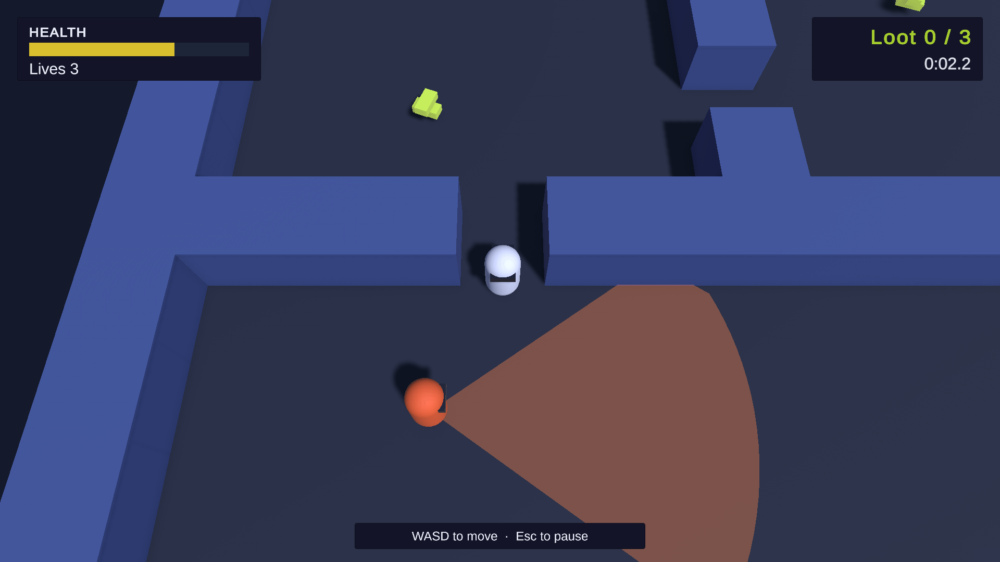
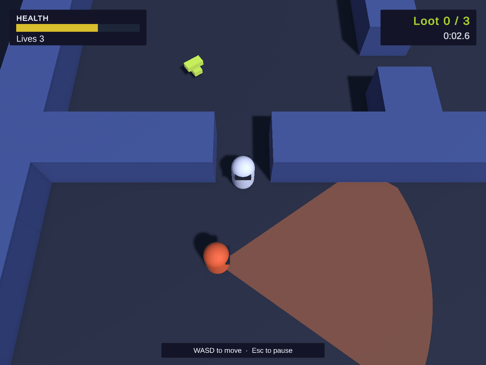
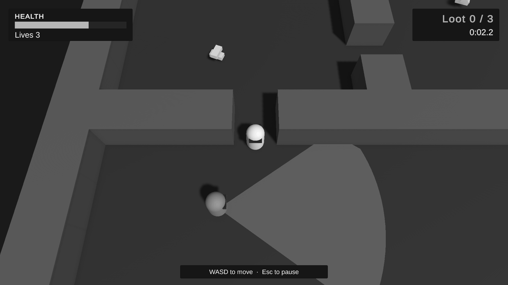

# CS464 Assignment 04 · Abdul Samad Sohail · BSSE23083

**Video (90–180 s):** https://drive.google.com/file/d/1S64MOjtg-A5R-iQa1rqX7M6AJncRBYDb/view?usp=drivesdk

I didn't build on my Assignment 03 project for this one. I started from a new Unity 6.3 project with all seven scenes. The game is called **Night Shift**. It's a small top down heist game: you sneak past guards and blinking lasers, take all the loot in the level, and then get to the exit pad. If a guard sees you (the orange cone) you get zapped. You have 3 lives per level.

Controls: WASD or arrow keys to move, Esc to pause. All the menus work with arrow keys and Enter.

## Settings

| Part | Setting | Value | Why |
|---|---|---|---|
| A | Harmony · base hue | split-complementary · 225° | Blue fits a night time break-in. The two split colours (15° and 75°) gave me one colour for danger and one for loot |
| A | Dark · mid · light | #14192B · #3F528C · #E6EAF7 | Dark is the panels and background, mid is the walls, light is the text and the player, so the player is the brightest thing on screen |
| A | Accents | #F26130 · #A4CC2D | Orange-red is everything that hurts you (guards, cones, lasers), green-yellow is the loot and the loot counter |
| A | HUD text (#E6EAF7) on the HUD panel (#14192B) | 14.52 : 1 | Text sits on a solid panel, not on the level. Loot text (#A4CC2D) on the same panel is 9.35 : 1 |
| A | Button label (#14192B) on the button (#627FD9) | 4.62 : 1 | White on that button was only 3.78 : 1, so I used a dark label. The selected button turns light so it's easy to see with the keyboard |
| B | Music · SFX groups, as mixed | 0 dB · -3 dB | Music is controlled by the slider so it stays at 0, the effects are a bit lower so they don't get annoying |
| B | Slider at 1 · 0.5 · 0.0001 | 0 dB · -6 dB · -80 dB | Mathf.Log10(value) * 20, so half the slider sounds like half the volume |
| C | Guard footsteps, in Levels 1-5 (on every guard) | Logarithmic · Min 1.5 m · Max 12 m | Footsteps are a small sound so they only get loud when the guard is close. You can hear one coming round a corner before you see him, which is the whole point in a sneaking game |
| C | Exit hum, in Levels 1-5 (on the exit pad) | Linear · Min 2 m · Max 24 m | The pad is about 2 m wide. Linear fades evenly so you can hear it from most of the level and follow it, and it's silent past 24 m |
| C | AudioListener | on the player (Listener object) | The camera is ~14 m above the player, so with the listener on the camera everything would sound far away. ListenerOnPlayer keeps it on the player with a fixed rotation so left/right matches the screen |
| D | unlocked | int · default 1 | Level 1 is always open, even on a fresh install |
| D | best1 … best5 | float · HasKey first | No key means no time yet. A default of 0 would look like a time nobody can beat |
| D | MusicVolume | float · default 1 | Full volume the first time you play |

## Answers

1. **What `Time.timeScale = 0` stops in my game, and what it doesn't:** It stops anything that uses Time.deltaTime or Time.time: the player moving, guards walking, lasers blinking, the loot spinning, particles and the level timer. It doesn't stop Update, so Esc and the menu keys still work. That's also why the player checks PauseMenu.IsPaused. Sound keeps going too, so pausing also sets AudioListener.pause. The health bar's lag and the loading bar use unscaled time so they still move.

2. **What survives a LoadScene in my game, and how:** The music player and the SfxPlayer use DontDestroyOnLoad with the singleton check, so there's only ever one of each. PlayerPrefs (unlocked levels, best times, music volume) are on disk. Statics also survive: PauseMenu.IsPaused, SfxPlayer.Instance, Time.timeScale and AudioListener.pause. Because of that, Restart and Quit call Resume() first, and LevelLoader sets timeScale back to 1. Everything else, including the HUD and loader, gets rebuilt.

3. **Why every PlayerPrefs read in my game has a default:** The first time someone plays, or after Clear All PlayerPrefs, none of the keys exist. Without a default, GetInt("unlocked") gives 0, so even Level 1 would be locked. MusicVolume would come back as 0, and Log10(0) is minus infinity, so the music would be silent. Best times use HasKey first, because a fake 0 time would beat every real run.

4. **An exception a forgotten unsubscribe would throw, and why mine can't:** Say CameraShake did += on health.Damaged but never -=. After a restart, the old listener would still be in the list while its camera was already destroyed. The next hit would then throw a MissingReferenceException ("CameraFollow has been destroyed"). In my game every listener (HealthBar, HitSound, HitSparks, CameraShake, LivesText, EndScreens) subscribes in OnEnable and unsubscribes in OnDisable. OnDisable runs when the scene unloads, so nothing old is left behind.

## Credits

- Music: "Sneaky Snitch" · Kevin MacLeod · https://incompetech.com · CC BY 4.0 (http://creativecommons.org/licenses/by/4.0/)
- Pickup (confirmation_001), menu click (click_001), guard alert (question_003) · Kenney, Interface Sounds · https://kenney.nl/assets/interface-sounds · CC0
- Player hit (impactPunch_heavy_000), guard footsteps (footstep_concrete_000 to 004) · Kenney, Impact Sounds · https://kenney.nl/assets/impact-sounds · CC0
- Win and lose (jingles_PIZZI02, jingles_PIZZI14) · Kenney, Music Jingles · https://kenney.nl/assets/music-jingles · CC0
- Exit hum (spaceEngineLow_000) · Kenney, Sci-fi Sounds · https://kenney.nl/assets/sci-fi-sounds · CC0
- Liberation Sans font · comes with TextMesh Pro · SIL Open Font License
- HealthBar, PauseMenu, LevelLoader and the singleton check are based on the CS464 lecture code
